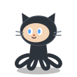

<div align="center">

  <!-- Side Characters -->
  
  

  <!-- 1. Typing Terminal Header -->
  <a href="https://git.io/typing-svg">
    
  </a>

  <br/>

  <!-- Quick Links -->
  <a href="https://leetcode.com/u/Royi15/">
    
  </a>

</div>

<br clear="both" />
<br/>

<!-- 2. Neofetch System Info -->
```text
royi@github
-----------
OS:         macOS / Windows / Linux (WSL2)
Focus:      Computer Science & Software Engineering
Languages:  C++, C, Python, Java, JS/TS, SQL, Bash
Frameworks: Node.js, Express, React, FastAPI
Game Dev:   Godot 4 (Jolt Physics), Blender
Tools:      Git, Docker, VS Code, Linux Networking
Interests:  Systems, Game Design, Theoretical Physics
```

<br/>

<!-- 3. Code Aquarium -->
<div align="center">
  <a href="https://github.com/hadoyyo/GitHub-Fish-Tank">
    
  </a>
</div>
